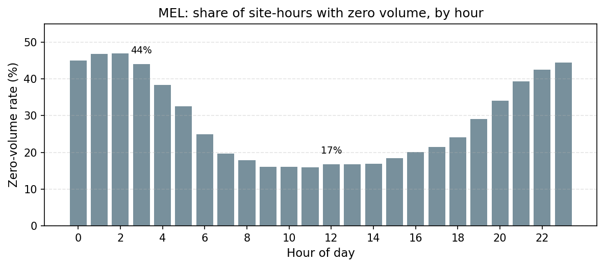

# 数据零值专项分析（MEL 充电量预测）

> 问题：volume.csv 里有 28.6% 的 0，历史窗口含 0 该怎么处理？「哪怕夜间也不该出现 0」？
>
> 结论：**0 是真实的「站点空闲」，不是缺失数据**。92% 的零值发生在站点正常运营期内，是夜间/低峰没人充电；仅 8% 是「站点尚未上线 / 已停运」（结构性零，应剔除，且已被全零窗口剔除覆盖）。

---

## 1. 零值的三个来源

对 MEL_remove_zero（62 站点，2023-04-01 ~ 09-30 共 4392 小时）逐站点、逐小时分类：

| 类型 | 占零值总量 | 含义 | 证据 | 处理 |
|---|---|---|---|---|
| 前导零 | 6.9% | 站点上线前（最长 3.4 个月全零） | 35 站点有前导零 | 剔除 |
| 尾随零 | 1.0% | 站点停运后（最长 25 天全零） | 27 站点有尾随零 | 剔除 |
| **活跃期内零** | **92.1%** | 站点正常运营中的空闲时段 | 见 §2/§3 | **保留** |

前导/尾随零本质是「站点不存在」，不是「需求为零」；活跃期内零才是需要判别的对象。

---

## 2. 证据一：零 = 「空闲」，不是「缺失数据」

**（a）volume 与 duration 完全一致。** 78005 个 volume=0 的样本中，78004 个 duration 也 =0（100%）；volume>0 但 duration=0 的仅 1 个。「没充电时长 ⟺ 没电量」，即「这一小时确实没车来」，而不是传感器掉线。跨城市复核：

| 城市 | volume=0 时 duration 也 =0 的比例 |
|---|---|
| MEL | 100.0% |
| LOA | 100.0% |
| AMS | 100.0% |
| JHB | 93.4% |

**（b）功率落在合理区间。** volume>0 时的 volume/duration ≈ 22 kW（中位），p5=7 kW，p95=75 kW，符合 EV 充电桩 7–75 kW 的真实功率，说明非零值连续可测、无截断。

**（c）零游程很短。** 活跃期内的零游程共 11987 段：**29% 是孤立单小时、49% ≤3h、85% ≤12h**，仅 17 段 ≥24h、0 段 ≥48h。若 0 是「传感器掉线/缺失」，应出现连续数天的长零段；现在看到的是短促的「这一两小时没人充」，是低利用率站点的真实形态。

---

## 3. 证据二：昼夜规律（MEL）

| 时段 | 零值率 |
|---|---|
| 凌晨 0–5 时 | 42.2% |
| 日间 10–14 时 | 16.5% |

夜间零值率是日间近 3 倍——**「夜间更闲」在 MEL 是真实且显著的**。凌晨 3 点，一个活跃站点约有 45% 概率该小时零充电。这不是坏值，是 2023 年墨尔本充电桩低利用率下的真实需求结构（且正是模型应学会的昼夜信号）。

---

## 4. 证据三：多城市对比——「夜间闲」不是普遍规律

| 城市 | 站点数 | 总体零值率 | 夜间(0–5时)零值率 | 日间(10–14时)零值率 |
|---|---|---|---|---|
| MEL | 62 | 28.6% | **42.2%** | 16.5% |
| JHB | 35 | 14.1% | 15.0% | 16.1% |
| LOA | 224 | 20.1% | 10.5% | **22.6%** |
| AMS | 1388 | 23.0% | 22.9% | 23.2% |

**两点结论**：
1. **零值是普遍真实的**（volume↔duration 跨城市 93–100% 一致）。
2. **零值的「时间分布」因城市而异**：MEL 夜间闲（42% vs 16%），LOA 反而日间更闲（22.6% vs 10.5%，可能是洛杉矶家庭夜间充电、日间公共桩空闲），JHB/AMS 无明显昼夜差。所以「夜间不该出现 0」只在部分城市成立，不能作为通用规则。

---

## 5. 处理建议

1. **活跃期内零（92%）——原样保留**。它是真实的低需求信号，插值或剔除会毁掉昼夜结构。
2. **前导/尾随零（8%）——剔除**。它们是「站点不存在」，且本身就是 72h 全零窗口，**已被当前的全零窗口剔除覆盖**。
3. **可选加强**：按站点「活跃期 mask」把「站点中途上线/停运」的过渡窗口（历史一半 0 一半有值，~1%）也严格掉。量级很小，暂不必要。

**对建模的两个实际影响**：
- **实例归一化**：长零段（前导/尾随）会让 loc→0、scale→eps 爆炸——这正是全零窗口剔除要解决的，现已处理。
- **外部模态信号污染**：POI/卫星描述的是「当前站点」，而站点上线前的历史是 0。若这些结构性零进入训练，会让「POI 繁华 ↔ 需求高」的关系被「POI 繁华但历史=0」的矛盾样本稀释——这可能是 L2 阶段 1 静态注入无增量的一个被低估的原因。

---

*附：本分析脚本逻辑见正文；图表 [figures/mel_zero_by_hour.png](figures/mel_zero_by_hour.png)。*
